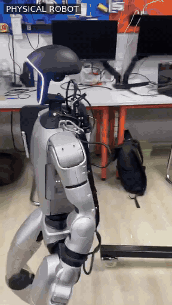
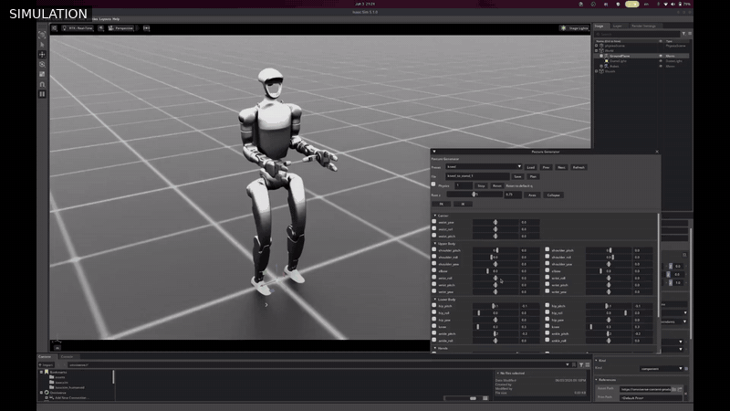
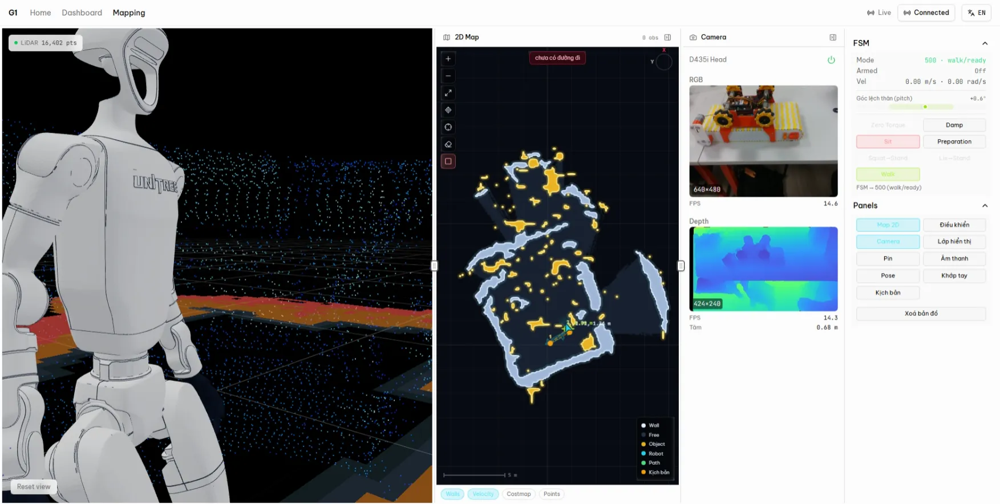

# Unitree G1: Vision-Guided Manipulation & Humanoid Learning

A humanoid robotics project at Advanced Computing Lab (ACLAB), HCMUT, in collaboration with Heineken. The project combines mobile navigation, visual object understanding, and arm manipulation for box handling on a Unitree G1, alongside simulation research on whole-body control. The goal is to connect the decisions involved in a physical task: navigate to an object, estimate its pose, reach toward it, and coordinate manipulation with the robot's body.

  

The physical G1 approaches the box, performs arm manipulation, and carries it through the laboratory. The deployed stack combines Nav2 navigation with YOLO target detection, FoundationPose object-pose estimation, and inverse kinematics for the arms.

### Simulation and training

Simulation experiments investigate reinforcement learning for humanoid locomotion and whole-body control, including policy training under motion-tracking objectives, payload constraints, and randomized disturbances, with AMP (Adversarial Motion Priors) motion imitation. 

The combined showcase brings together posture preparation, commanded walking with a payload, parallel body-motion experiments, perturbation responses, and lowering/posture transitions.

- **Walking and carrying:** study velocity tracking and body support while holding a payload.
- **Posture holding and recovery:** investigate responses to changing poses and external disturbances, including failure cases.
- **Motion tracking:** develop body trajectories and transitions that support reaching, lowering, and manipulation.

### Development dashboard

The development dashboard combines a 3D robot/point-cloud view, a 2D navigation map, live RGB and depth observations, and robot/task state. It provides a shared view of navigation, perception, and the robot's operating state during development and testing.
